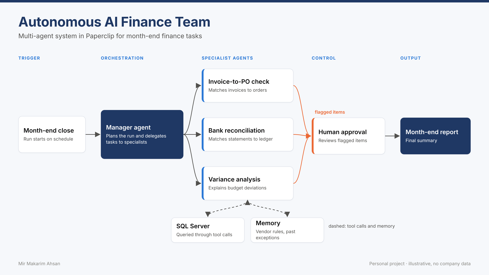

# 🤖 Autonomous AI Finance Team

**A multi-agent system for month-end close: a manager agent delegates invoice checks, bank reconciliation and variance analysis to specialist agents, and a human approves every flagged item before the report goes out.**




## The problem

Month-end close repeats the same checks every month: match invoices to purchase orders, reconcile the bank, explain budget deviations. The work is rule-based but needs judgement on the exceptions. This project lets agents do the routine checks and leaves the decisions to a person.

## How it works

| Agent | Job | Tools |
|---|---|---|
| **Manager agent** | Plans the run, delegates, routes exceptions to the reviewer, writes the report | all |
| **Invoice-to-PO check** | Two-way match of price and quantity, invoices without PO, duplicate invoices | SQL, memory |
| **Bank reconciliation** | Matches ledger payments to bank lines by reference, then by amount and date | SQL, memory |
| **Variance analysis** | Budget vs actual per cost center, names the vendors behind each overrun | SQL, memory |
| **Human approval** | Approves or rejects each flagged item; approvals are remembered | terminal |

**Design choices**

- **Read-only tool access:** agents query the database only through `SqlTool`, which opens the file read-only and rejects anything that is not a single `SELECT`.
- **Memory across runs:** vendor rules (for example a wider price tolerance for a freight vendor) and approved exceptions are stored in `data/memory.json`. Approved items are not raised again next month.
- **Human in the loop:** nothing is closed automatically. Every exception goes to the reviewer, most severe first.
- **LLM optional:** with `ANTHROPIC_API_KEY` set and `anthropic` installed, the manager writes the executive summary with a language model. Only aggregated findings are sent. Without a key, a template is used and everything runs offline.

## Example output

The sample database contains planted issues. One run finds all of them:

| Severity | Agent | Item |
|---|---|---|
| high | Invoice-to-PO check | Possible duplicate invoice V102-9008 |
| high | Variance analysis | CC-IT +42.9% over budget |
| high | Invoice-to-PO check | INV-0005 price +8.0% vs PO |
| high | Bank reconciliation | Bank line BS-0099 has no ledger entry |
| high | Bank reconciliation | PAY-0032 not found on bank statement |
| high | Invoice-to-PO check | INV-0042 has no purchase order |
| medium | Variance analysis | CC-LOG +25.0% over budget |
| low | Bank reconciliation | PAY-0013 differs by -15.00 (bank fee) |

Full report: [`docs/sample-month-end-report.md`](docs/sample-month-end-report.md)

## How to run it

Requires Python 3.10 or newer. No packages needed for the offline mode.

```bash
git clone https://github.com/MirMakarim/ai-finance-agent-team.git
cd ai-finance-agent-team

python run.py              # review each flagged item in the terminal
python run.py --auto       # demo mode: policy reviewer approves low-severity items
python run.py --reset      # forget earlier approvals

python -m unittest discover tests     # 6 tests
```

Optional LLM summary:

```bash
pip install -r requirements.txt
export ANTHROPIC_API_KEY=...          # never commit your key
python run.py --auto
```

The report is written to `output/month_end_report_<period>.md`.

## Repository structure

```
ai-finance-agent-team/
├── run.py                         # entry point
├── finance_team/
│   ├── manager.py                 # manager agent: plan, delegate, route, summarise
│   ├── agents/
│   │   ├── invoice_po_check.py
│   │   ├── bank_reconciliation.py
│   │   └── variance_analysis.py
│   ├── db.py                      # sample SQLite database + read-only SQL tool
│   ├── memory.py                  # vendor rules and approved exceptions
│   ├── approval.py                # human reviewer (console) and policy reviewer
│   ├── llm.py                     # optional LLM summary
│   └── report.py
├── tests/test_agents.py
└── docs/
```

## Background

I first built this agent team in Paperclip with SQL Server as the data source. This repository is a portable Python version of the same design: same agents, same tool and memory concepts, same approval step, running on a local SQLite database so anyone can try it.

## What I learned

- Agents work best with narrow jobs and narrow tools. A read-only SQL tool removes a whole class of risks.
- Memory turns a one-off check into a process that learns: approved exceptions stop coming back.
- The human approval step is what makes automation acceptable in finance.

---

<sub>All data is fictional and generated by `finance_team/db.py`. No company data is included.</sub>
